<div align="center">

# 🐾 Barbiku × Refloresta 🌳

**Cada mascota asegurada puede dejar huella en el planeta.**

Al dar de alta el seguro de su mascota, el cliente planta un árbol autóctono en su honor y recibe una chapa ecológica grabada con su nombre.


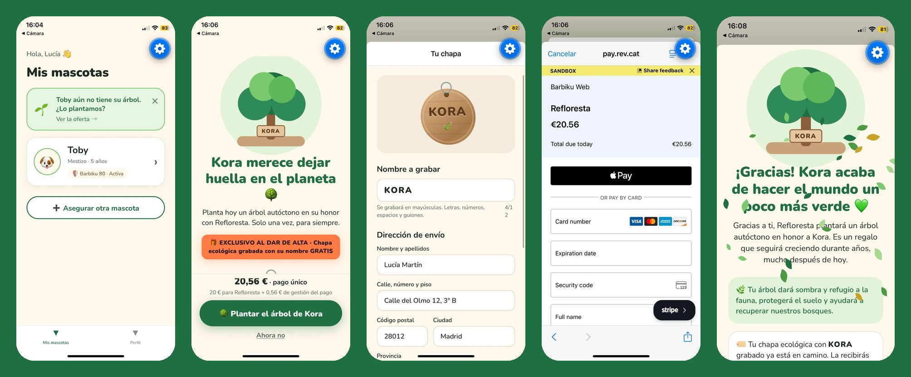

<sub>Proyecto de hackathon. Barbiku (aseguradora de mascotas) y Refloresta (ONG de reforestación) son marcas <strong>ficticias</strong>. Todos los pagos son en modo test.</sub>

</div>

---

## 💡 La idea

| | Qué gana |
|---|---|
| 🌱 **Refloresta** | **20 € netos por árbol**. El precio (20,56 €) incluye exactamente la comisión de Stripe. |
| 🐶 **El cliente** | Un árbol plantado en honor a su mascota, una **chapa ecológica grabada** y una tarjeta para compartir. |
| 🛡️ **Barbiku** | Reputación y fidelización justo en el momento del alta. |
| 💳 **RevenueCat** | Gestiona la compra, el checkout de Stripe y los eventos de pago. |

Al cliente **nunca** se le muestra el estado del árbol: ni "pendiente", ni "plantado", ni ubicación. La experiencia gira en torno a haber ayudado. Lo único con seguimiento es la **chapa** (Recibido → Grabando → Enviado).

## 📱 La app en funcionamiento

<table>
  <tr>
    <td align="center" width="33%">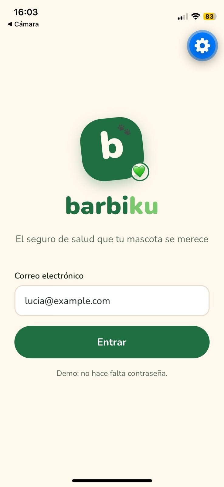<br /><b>1. Entrar</b><br /><sub>Login de demo, sin contraseña</sub></td>
    <td align="center" width="33%">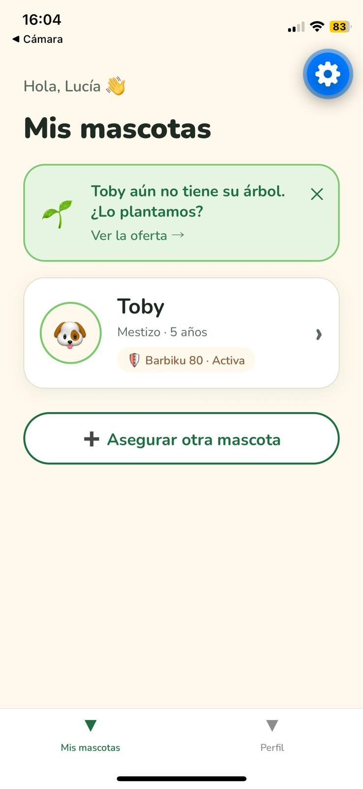<br /><b>2. Mis mascotas</b><br /><sub>Recordatorio amable de la oferta</sub></td>
    <td align="center" width="33%">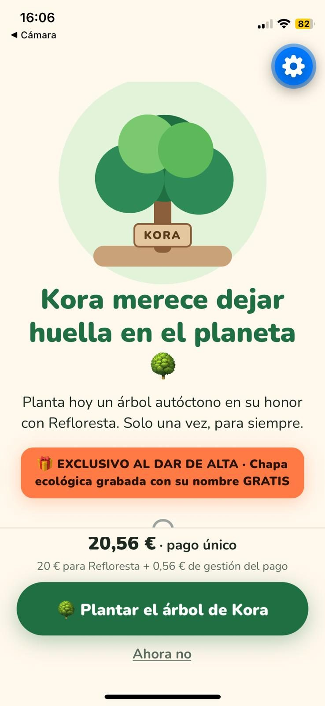<br /><b>3. La oferta</b><br /><sub>Tras el alta, personalizada con su nombre</sub></td>
  </tr>
  <tr>
    <td align="center">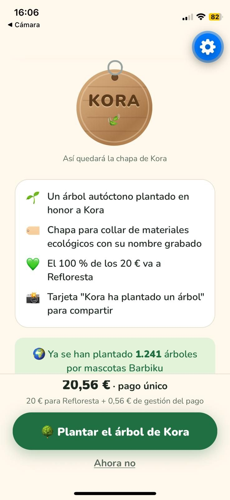<br /><b>4. Chapa y beneficios</b><br /><sub>Precio claro y contador real de árboles</sub></td>
    <td align="center">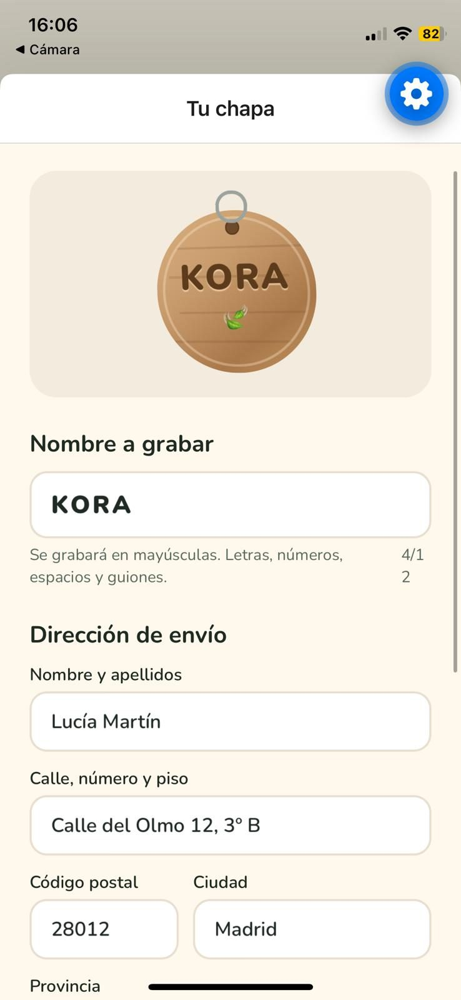<br /><b>5. Grabado y envío</b><br /><sub>Vista previa en vivo de la chapa</sub></td>
    <td align="center">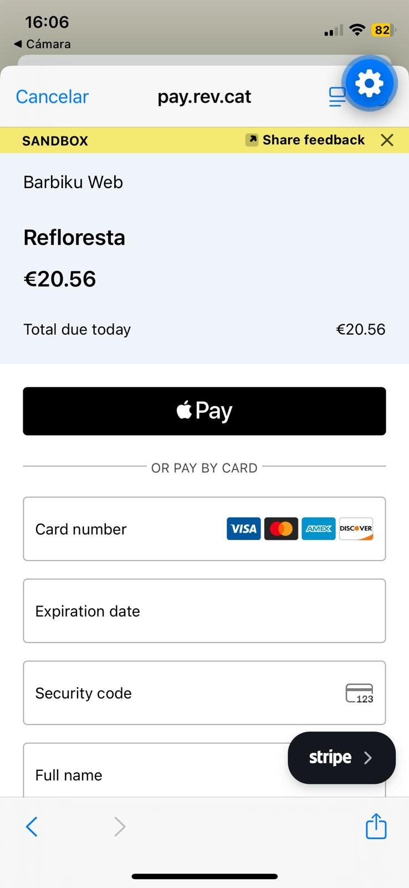<br /><b>6. Pago</b><br /><sub>RevenueCat Web Billing + Stripe (sandbox)</sub></td>
  </tr>
  <tr>
    <td align="center">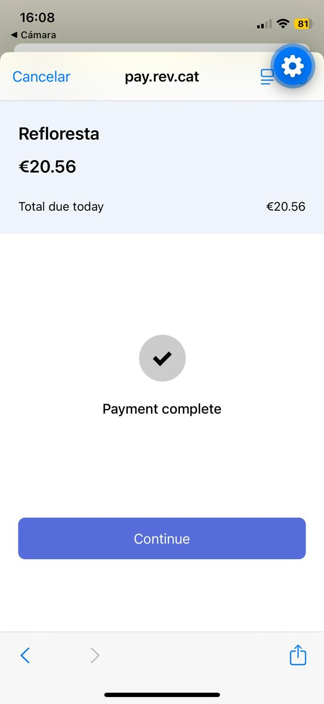<br /><b>7. Pago completado</b><br /><sub>El webhook marca el pedido como pagado</sub></td>
    <td align="center">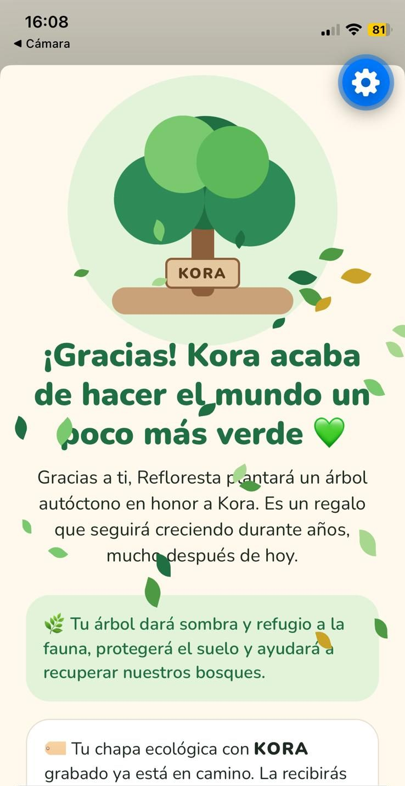<br /><b>8. ¡Gracias!</b><br /><sub>Confeti de hojas y mensaje emotivo</sub></td>
    <td align="center">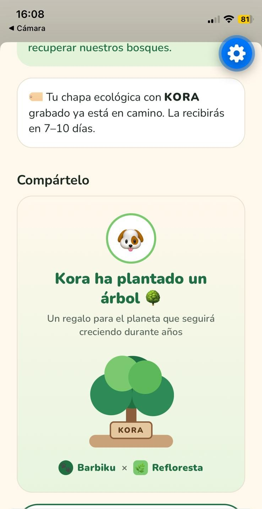<br /><b>9. Compártelo</b><br /><sub>Tarjeta lista para redes</sub></td>
  </tr>
</table>

## ✨ Qué incluye

- **Flujo de aseguradora simulado:** login, mis mascotas, alta del seguro con dos planes y confirmación animada.
- **Oferta agresiva pero honesta:** "Ahora no" siempre visible, sin cuentas atrás ni escasez inventada, y precio total desglosado antes de pagar.
- **Chapa en vivo:** el nombre se valida (12 caracteres, letras con Ñ y tildes, filtro de palabras ofensivas) y se ve grabado mientras se escribe.
- **Una compra por mascota:** producto consumible en RevenueCat. Cada pago va ligado a su pedido mediante `metadata[order_id]`.
- **Webhook idempotente:** RevenueCat → Edge Function → pedido `paid`. Los reembolsos pasan a `refunded`.
- **Privacidad por diseño:** la app solo puede crear pedidos y leer `id, mascota, estado de la chapa, estado del pago`. `tree_planted` nunca sale hacia el cliente.
- **Panel interno** (5 toques en el logo): pestaña **Chapas** para Barbiku y pestaña **Árboles** para Refloresta, con totales.
- **Modo demo sin backend:** con `EXPO_PUBLIC_DEV_FAKE_PURCHASE=true` todo funciona sin cuentas externas.

## 🧭 Cómo funciona el pago

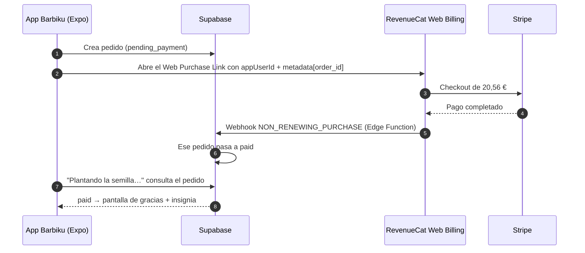

## 🔐 Panel interno

Se abre con **5 toques en el logo** de la pantalla de login y un código de acceso. El código lo valida la Edge Function `admin-orders`: la app nunca usa la *service role key*.

| Pestaña | Para quién | Qué muestra | Acciones |
|---|---|---|---|
| **Chapas** | Equipo Barbiku | Nombre a grabar, dirección de envío y estado de la chapa | Pasar a **Grabando** y a **Enviado**. El cliente lo ve en la ficha de su mascota |
| **Árboles** | Refloresta | **Solo** el nombre de la placa, la especie, la provincia y la fecha. Sin email ni dirección completa | **Marcar plantado**, de uso interno: nunca llega a la app del cliente |

Arriba se ven los totales: árboles financiados y euros para Refloresta (pagados × 20 €).

## ✅ Estado del MVP

- [x] Guion de la demo completo de principio a fin con Stripe en modo test, probado en iPhone con Expo Go.
- [x] El webhook pasa el pedido de `pending_payment` a `paid` y es idempotente por el `id` del evento.
- [x] Una compra por mascota. La insignia "Guardiana del Bosque" se contrasta siempre con el pedido pagado en el servidor.
- [x] Ninguna pantalla ni respuesta de la API para el cliente revela el estado del árbol.
- [x] 20,56 € en la app y en RevenueCat, que dejan 20 € netos según [`pricing.ts`](src/config/pricing.ts).
- [x] "Ahora no" siempre visible, sin urgencia falsa. Banner de recuerdo durante 7 días.
- [x] `tsc --noEmit`, ESLint y los tests pasan sin errores.

## 🛠️ Stack

| Capa | Tecnología |
|---|---|
| App | Expo SDK 58 · React Native · TypeScript · Expo Router |
| UI | StyleSheet · Reanimated · Nunito |
| Pagos | RevenueCat Web Billing (`react-native-purchases`) · Stripe |
| Backend | Supabase: Postgres con RLS + Edge Functions (Deno) |
| Estado | Zustand + AsyncStorage |

## 🚀 Puesta en marcha

### Requisitos
- **Node 22.13 o superior** (lo exige Expo SDK 58) y npm.
- Para móvil, **Expo Go** (misma cuenta de Expo en el teléfono y en `npx expo login`). Para web basta un navegador.

### Instalación
```bash
npm install
cp .env.example .env      # en Windows: copy .env.example .env
npx expo start            # escanea el QR con Expo Go, o pulsa "w" para la web
```
Con el `.env` tal cual (`EXPO_PUBLIC_DEV_FAKE_PURCHASE=true` y sin claves de Supabase) **toda la demo funciona sin backend**:
- La compra se simula.
- Los pedidos se guardan en memoria. Al recargar, el panel interno se vacía.
- El código del panel interno es `1234`.

### Variables de entorno (`.env`)
| Variable | Valor |
|---|---|
| `EXPO_PUBLIC_REVENUECAT_API_KEY` | Clave pública de la app Web Billing en RevenueCat (`rcb_…`) |
| `EXPO_PUBLIC_REVENUECAT_IOS_API_KEY` / `_ANDROID_API_KEY` | Opcionales, solo para development builds nativas (`appl_…` / `goog_…`) |
| `EXPO_PUBLIC_RC_WEB_PURCHASE_LINK` | URL del Web Purchase Link, sin el usuario al final (`https://pay.rev.cat/…`) |
| `EXPO_PUBLIC_SUPABASE_URL` | `https://<PROJECT_REF>.supabase.co` |
| `EXPO_PUBLIC_SUPABASE_ANON_KEY` | Clave anon pública (o *publishable key*) de Supabase |
| `EXPO_PUBLIC_APP_SCHEME` | `barbiku` |
| `EXPO_PUBLIC_DEV_FAKE_PURCHASE` | `true` simula el pago. Ponlo a `false` para pagar con Stripe test |

Los secretos `RC_WEBHOOK_AUTH` y `ADMIN_PASSCODE` **no van en `.env`**: se guardan como *secrets* de Supabase.

### Configuración externa paso a paso
1. **Supabase** (tablas, RLS, Edge Functions, secrets): [`docs/backend.md`](docs/backend.md).
2. **RevenueCat + Stripe** (Web Billing, producto consumible, offering `default`, Web Purchase Link, webhook): [`docs/revenuecat.md`](docs/revenuecat.md).
3. **Stripe:** comprueba la tarifa de las tarjetas del EEE. Si no es 1,5 % + 0,25 €, ajusta [`src/config/pricing.ts`](src/config/pricing.ts) y el precio del producto en RevenueCat.

Tarjeta de prueba: `4242 4242 4242 4242`, con cualquier fecha futura y cualquier CVC.

### Scripts
| Comando | Qué hace |
|---|---|
| `npx expo start` | Arranca la app (móvil con Expo Go o web) |
| `npm run typecheck` | `tsc --noEmit` |
| `npx eslint src` | Lint |
| `npx tsx src/lib/engraving.test.ts` | Tests del grabado y del precio |
| `npm run test:webhook` | Pruebas del webhook contra Supabase (ver `docs/backend.md`) |

## 🎬 Guion de la demo (2 minutos)
1. Login → inicio con Toby y el banner de recuerdo.
2. "Asegurar otra mascota" → alta de Luna → "Luna ya está protegida" → se abre la oferta.
3. "Plantar el árbol de Luna" → grabado y dirección → pago con Stripe test → "Plantando la semilla…" → gracias, con confeti → compartir la tarjeta.
4. Ficha de Luna: insignia "Guardiana del Bosque" y chapa en "Recibido".
5. Panel admin: el pedido aparece en Chapas y en Árboles. Pasar la chapa a "Grabando" se refleja en la ficha. "Marcar plantado" no cambia nada para el cliente.

## 📂 Estructura
```
src/app/          Pantallas (Expo Router): login, inicio, alta, oferta, envío, procesando, gracias, ficha, admin
src/components/   Chapa, árbol animado, CTA, confeti, tarjeta para compartir (+ seguro/)
src/lib/          revenuecat.ts · supabase.ts (con mock) · engraving.ts
src/store/        Zustand + AsyncStorage
supabase/         Migración SQL y Edge Functions (webhook y panel admin)
docs/             Contratos, guías de configuración, notas del reto y capturas
```

## 📚 Documentación

| Documento | Contenido |
|---|---|
| [`CLAUDE.md`](CLAUDE.md) | Especificación completa del producto: flujo, pantallas, datos y requisitos innegociables |
| [`docs/CONTRATOS.md`](docs/CONTRATOS.md) | Tipos, rutas y API compartidos entre módulos |
| [`docs/backend.md`](docs/backend.md) | Supabase: migración, RLS, Edge Functions, secrets y pruebas del webhook |
| [`docs/revenuecat.md`](docs/revenuecat.md) | RevenueCat Web Billing + Stripe: producto, offering, Web Purchase Link y webhook |
| [`docs/notas/`](docs/notas) | Idea original y planteamiento del reto |

> `SOCIAL_PROOF_BASE = 1240` es una cifra base **ficticia** para el contador de la oferta. El número mostrado es esa base más los pedidos pagados reales.
